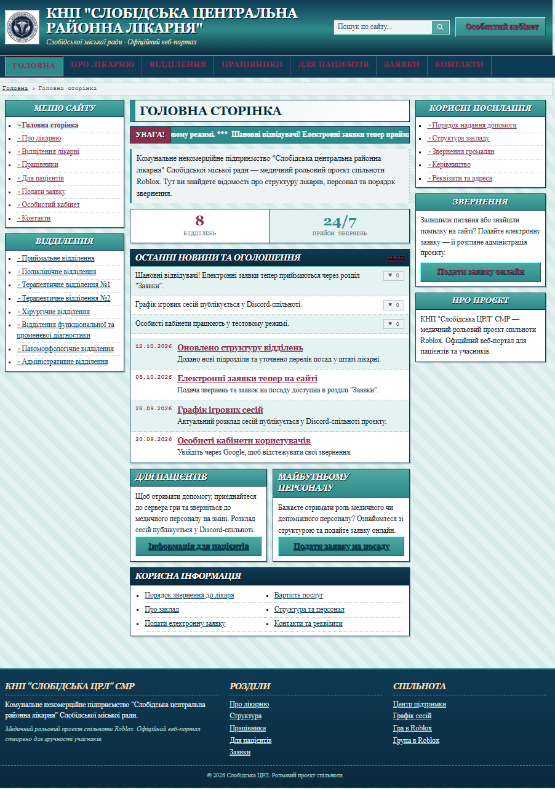

<div align="center">

# Official Sloboda Hospital Web Portal



</div>

## Overview

Official Web-Portal of Sloboda Hospital: intentionally "Soviet" government style (teal/navy, marquee ticker, tables), multi-page static site built with Vite + TypeScript.

## Project Structure

```text
SH-Site/
├── public/        ads/ audio/ avatars/ brand/ gallery/ img/ video/, sw.js
├── src/           Frontend (React, MPA navigation via AppLink)
│   ├── pages/     HomePage, ApplicationsPage, CabinetPage, StaffPage, ...
│   ├── data/      forms.ts, hierarchy.ts, staff.ts, roles.ts
│   └── api.ts     Client for the Cloudflare Worker
```

## Tech Stack

- **Frontend:** TypeScript, React, Vite, oxlint
- **Backend:** Cloudflare Workers, D1 (SQLite), Google OAuth 2.0, Resend (email)
- **Hosting:** GitHub Pages (frontend) + Cloudflare (API)

## Roles

- `patient` — default after login
- `main_director`, `med_director`, `deputy_director`, `department_head`, `operator` — assigned by gen/med directors via the cabinet (by email or invite link)

---

<div align="center">

Built by **xeraze** for **Sloboda Hospital**

</div>