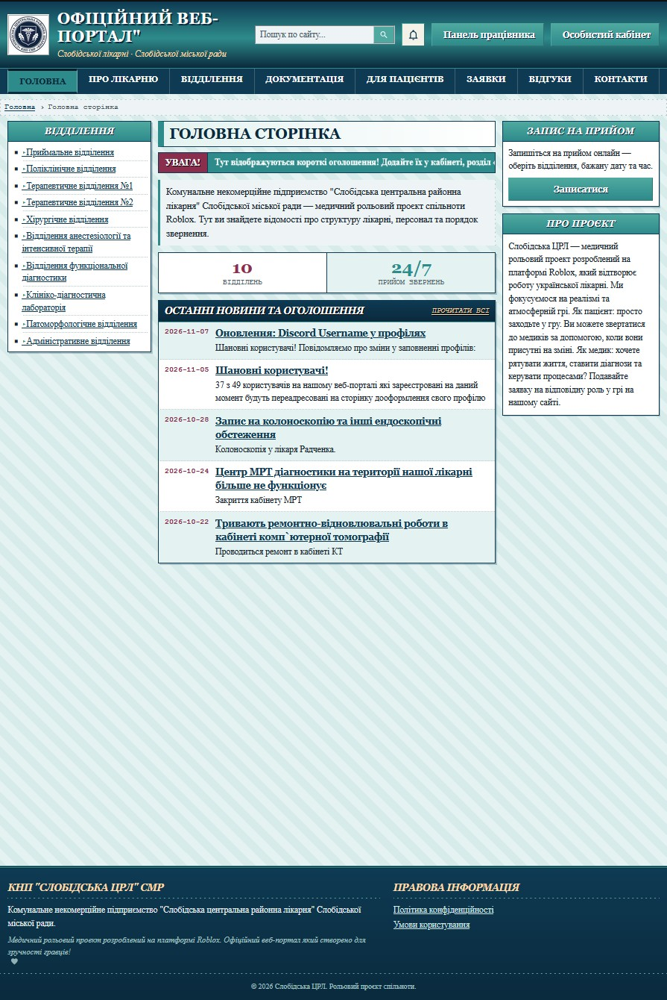

# Офіційний веб-портал "Слобідська ЦРЛ"
# Official Web Portal of the "Sloboda Hospital"

## Про проект | About project

Веб-портал медичного рольового проєкту "Слобідська ЦРЛ" розроблений на платформі Roblox. На даному веб-порталі можна знайти: інформацію про лікарню, сервіси для гравців та інструменти для працівників. Оформлення у ретростилі державних вебсайтів із бірюзово-синьою палітрою, таблицями та рухомим інформаційним рядком.

The web portal for the medical role-playing project “Sloboda Hospital” which was developed on the Roblox. On this web portal, you can find: information about the hospital, services for players, and tools for staff. This is designed in the retro style of government websites, featuring a teal-blue color palette, tables and a scrolling information bar.

## Можливості | Features

- **Відділення:** 10 відділень, лічильники працівників, картки персоналу та публічні профілі.
- **Пошук:** сторінки, оголошення й персонал за ПІБ, посадою, спеціалізацією та відділенням.
- **Особистий кабінет:** профіль, дані акаунта та налаштування сповіщень.
- **Панель працівника:** робота із заявками, зверненнями та записами на прийом.
- **Управління персоналом:** пошук, фільтри, призначення посад, ролей і спеціалізації, зміна статусу.
- **Матеріали:** оголошення, документація та архів.
- **Сповіщення:** колокольчик із переходами до відповідних заявок і записів.
- **Навігація:** адаптивна шапка, меню акаунта та путівник.
---
- **Departments:** 10 departments, employee headcount, staff cards and public profiles.
- **Search:** pages, announcements and staff by full name, position, specialization and department.
- **Personal Account:** profile, account information and notification settings.
- **Employee Dashboard:** Manage requests, inquiries and appointments.
- **HR Management:** Search, filters, assign positions, roles, specializations, and change status.
- **Resources:** announcements, documentation and the archive.
- **Notifications:** a bell icon with links to relevant requests and appointments.
- **Navigation:** responsive header, menu, and site map.

## Технології | Technologies

- **Front-end:** TypeScript, HTML, CSS
- **Back-end:** Cloudflare Workers, D1 (SQLite), R2
- **Frameworks:** React
- **Libraries:** React Router, Iconify (`mdi:`), html2pdf.js
- **Other:** Vite, oxlint, OAuth, Cloudflare Turnstile, Resend, GitHub Pages

Створено **xeraze** для РП проєкту **"Слобідська ЦРЛ"**.

Created by **xeraze** for RP project **"Sloboda Hospital"**

